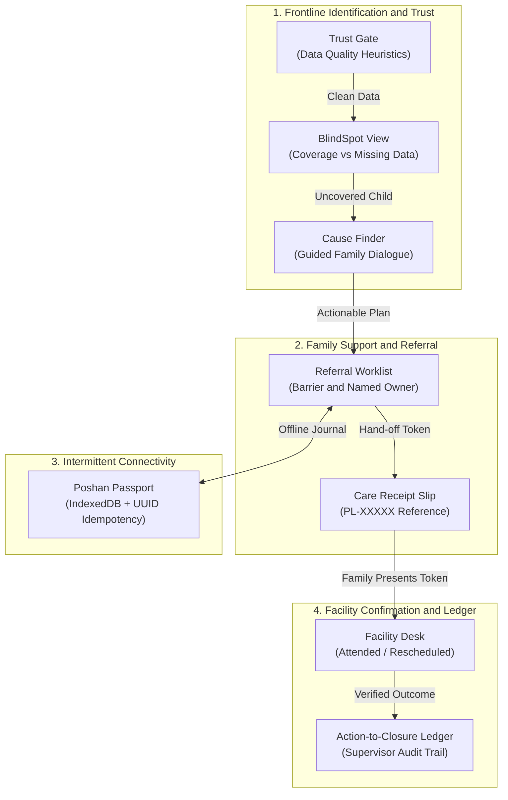

# POSHANLOOP &mdash; Operational Continuity &amp; Action-to-Closure System
### Last-Mile Maternal &amp; Early-Childhood Nutrition Follow-Up for the India @ 71/100 Challenge

[](#)
[](#)
[](#)
[](#)
[](#)

---

## 📌 Executive Summary

**POSHANLOOP** is a frontline public-service prototype designed to solve one specific, critical breakdown in maternal and early-childhood nutrition delivery: **the drop-off between a child being flagged and the next step of support being confirmed.**

Existing systems like Poshan Tracker capture growth data and notify workers. However, in the field, entering a number into a tablet or sending an SMS does not mean the child received nutrition care. 

### The Core POSHANLOOP Rule
> **"A case is not complete because a number was entered or a message was sent.**  
> **It is complete only after the next action and receiving-side outcome are recorded."**

POSHANLOOP does **not** replace Poshan Tracker, clinical records, or frontline worker judgement. It works alongside them to provide **operational continuity** &mdash; guaranteeing a closed-loop trail from initial measurement check to verified facility outcome.

---

## 💡 Important Differentiation

Many hackathon and challenge proposals focus on biometric fusion, ABHA identity resolution, WHO LMS clinical velocity scoring, or composite clinical risk indices with arbitrary 48-hour SLAs. 

**POSHANLOOP intentionally rejects that approach:**
- ❌ **No clinical diagnoses or risk scoring:** Clinical decisions belong exclusively to qualified medical doctors.
- ❌ **No biometric or Aadhaar identity matching:** Uses neutral child IDs (`CH-0001`) and non-identifying tokens.
- ❌ **No arbitrary clinical countdowns:** Frontline scheduling responds to real family barriers, not rigid synthetic SLAs.
- ❌ **No replacement of frontline judgment:** Focuses on logistical, transport, and administrative follow-up.

### The Proposed Contribution: Low-Burden Operational Continuity
1. **Measurement Confidence:** Catching data entry typos before they trigger false alarms.
2. **Coverage BlindSpot Visibility:** Distinguishing confirmed concerns from missing, overdue data.
3. **Barrier Capture with Named Ownership:** Recording *why* a family struggles to reach care and *who* helps next.
4. **Non-Sensitive Care Receipt:** A 5-character referral token (`PL-7K4M2`) that eliminates PII from plain messages.
5. **Offline Event Journaling:** Device-level IndexedDB capture with UUID idempotency and conflict review.
6. **Receiving-Side Outcome Ledger:** Enforcing that cases close only when facility arrival or supervisor reason is recorded.

---

## 🧱 System Architecture



---

## 🌟 The 6 Core Features

### 1. 🛡️ Trust Gate &mdash; Measurement Confidence &amp; Re-Check Trail
* **Purpose:** Helps frontline workers catch obvious data entry errors (missing units, duplicate clicks, impossible jumps) without blaming workers or pretending to make medical diagnoses.
* **Administrative Checks:** Missing measurement date, missing unit, future dates, duplicate measurements on the same day, 3+ repeated identical readings, and sudden jumps exceeding configurable thresholds (e.g. &gt;3 kg weight change).
* **Immutability:** Original records are **never overwritten or deleted**. Corrections are saved as linked audit events (`corrected_by_id`) documenting who changed it and why.
* **Statuses:** `Needs review`, `Re-measurement requested`, `Verified`, `Corrected`, `Clear`.

### 2. 👁️ BlindSpot &mdash; Unknown-versus-Risk Coverage Visibility
* **Purpose:** Prevents missing data from being mistaken for a healthy child.
* **Three Strict States:**
  1. 🟢 **Up to date:** Valid measurement recorded within expected schedule (&le; 30 days).
  2. 🟡 **Unknown / Overdue:** No valid measurement on file. *Missing data is NOT healthy data.*
  3. 🔴 **Confirmed concern:** Explicitly flagged by authorized staff or clinical referral.
* **Privacy-First:** Grid displays **aggregate centre-level numbers only**. Zero personal names, home addresses, or coordinates are ever placed on maps.

### 3. 🤝 Referral Helper &mdash; Barrier-to-Action Plan
* **Purpose:** Solves the root reason referrals fail: practical family obstacles.
* **Barrier Checklist:** Travel distance, transport costs, no accompanying adult, childcare responsibilities, seasonal migration/brick kiln movement, facility timing conflicts, unclear instructions.
* **Named Single Ownership:** Every referral has one named owner (AWW, ASHA/ANM, or Facility Staff), a concrete next action, and a local due date.
* **Non-Clinical Priority:** Ordering sequence (`routine`, `urgent`, `high`) manages worker workload &mdash; it never denies a service.

### 4. 🎫 Care Receipt &mdash; Simple Hand-off Token
* **Purpose:** Replaces bulky medical dossiers with a lightweight, non-stigmatising paper or SMS hand-off token.
* **Format:** Random, non-identifying 5-character alphanumeric token (e.g., `PL-7K4M2`). Never encodes Aadhaar, child name, date of birth, or medical condition.
* **Printable Slip:** Single-page slip showing token, destination facility, OPD hours, and local worker help contact.
* **Receiving Side:** Facility staff enter the token to verify arrival without requiring patient identity lookup.

### 5. 📱 Poshan Passport &mdash; Offline Event Journal
* **Purpose:** Ensures reliable field operations in rural pockets with zero connectivity.
* **IndexedDB Architecture:** Field notes, measurements, and barrier updates are saved locally with client-generated UUID idempotency keys.
* **Conflict Resolution:** If server and local versions differ, POSHANLOOP never silently overwrites. Both versions are displayed side by side for human resolution.
* **Interactive Demo:** Includes an instant **Simulate Offline / Go Online** switch to demonstrate field sync live without unplugging network cables.

### 6. 💬 Cause Finder &mdash; Guided Supportive Conversation
* **Purpose:** Structures an empathetic home conversation with caregivers, not a diagnostic inquiry.
* **Admin-Approved Cards:** Pre-written guidance cards across diet diversity, illness recovery, water sanitation, and ration entitlement.
* **Mandatory Safety Disclaimer:** *"This is not a diagnosis or treatment recommendation. Clinical decisions belong to qualified medical personnel."*

---

## 👥 Core Demo Roles &amp; Permissions

POSHANLOOP features a built-in **Prototype Demo Role Switcher** to experience the app from all frontline perspectives:

| Role | Primary User | What They See &amp; Do |
|------|--------------|------------------------|
| **AWW** | Anganwadi Worker | Assigned children, records due, data-check tasks in Trust Gate, record measurements, home visit notes. |
| **ASHA / ANM** | Health Activist / Nurse | Assigned follow-ups, family barrier checklist, transport coordination, referral generation. |
| **Facility** | PHC / NRC Staff | Facility Desk, lookup by Care Receipt token (`PL-XXXXX`), acknowledge arrival, record clinical attendance outcome. |
| **Supervisor** | CDPO / Sector Lead | Area coverage heatmap, overdue follow-up queue, workload balance, system audit trail, authorized closure. |

> **Note:** The role switcher is a prototype demonstration control, not production authentication. In production, role-based access would integrate with government single sign-on (SSO).

---

## 📊 Comprehensive Seeded Scenarios

The prototype comes pre-loaded with **65 synthetic child records** across **3 blocks** (Nashik Urban, Nashik Rural, Sinnar) and **8 Anganwadi centres**.

| Scenario ID | Beneficiary ID | Feature Demonstrated | How to Inspect |
|-------------|----------------|----------------------|----------------|
| **SC-01** | `CH-0005` | Duplicate measurement on tablet | Open **Trust Gate** &rarr; inspect `DUPLICATE_ENTRY` flag |
| **SC-02** | `CH-0008` | Missing measurement unit | Open **Trust Gate** &rarr; click **Correct Value** &rarr; add `kg` |
| **SC-03** | `CH-0012` | Missing measurement date | Open **Trust Gate** &rarr; view `MISSING_DATE` alert |
| **SC-04** | `CH-0015` | Unchanged repeated values (3 months) | Open **Trust Gate** &rarr; view `REPEATED_VALUE` alert |
| **SC-05** | `CH-0020` | Unusually large weight jump (&gt;3kg) | Open **Trust Gate** &rarr; view `LARGE_CHANGE` alert |
| **SC-06** | `CH-0025` | Overdue / Unknown measurement (45d+) | Open **BlindSpot** &rarr; see amber count in centre grid |
| **SC-07** | `CH-0030` | Family with travel barrier &amp; Care Receipt | Open **Referrals** &rarr; inspect `PL-7K4M2` &amp; barrier notes |
| **SC-08** | `CH-0035` | Single mother / childcare barrier | Open **Referrals** &rarr; inspect `PL-3B8Q1` |
| **SC-09** | `CH-0040` | Waiting for facility acknowledgement | Open **Referrals** &rarr; token `PL-9X2L5` with status `Referred` |
| **SC-10** | `CH-0042` | Attended referral with recorded outcome | Open **Referrals** &rarr; token `PL-5M1N8` with status `Outcome recorded` |
| **SC-11** | `CH-0045` | Rescheduled hospital visit | Open **Referrals** &rarr; token `PL-8R4K7` with status `Rescheduled` |
| **SC-12** | `CH-0048` | Migrated family / not reached | Open **Supervisor View** &rarr; view in Escalation Queue |
| **SC-13** | `CH-0050` | Offline pending sync event | Open **Offline Queue** &rarr; view pending IndexedDB event |
| **SC-14** | `CH-0055` | Sync conflict with dual versions | Open **Offline Queue** &rarr; see conflict &amp; side-by-side review |

*All names, IDs, and values are 100% fictional and do not represent real individuals or clinical prevalence.*

---

## 🚀 Quick Start Guide (Windows)

### Prerequisites
- **Python 3.10+** (Tested on Python 3.13)
- **Node.js 18+** &amp; **npm** (Tested on Node v24.11)
- Modern web browser (Chrome, Edge, Firefox)

### Option 1: One-Click Launcher (Recommended)
Simply double-click the included batch launcher or run in terminal:
```cmd
run_demo.bat
```
*(Or in PowerShell: `./run_demo.ps1`)*

This script automatically:
1. Verifies your Python and Node environments.
2. Initializes SQLite database tables and seeds the 14 synthetic scenarios.
3. Launches the FastAPI backend on `http://localhost:8000`.
4. Launches the Vite React frontend on `http://localhost:5173`.

---

### Option 2: Manual Terminal Execution

#### 1. Backend Setup
In a terminal window:
```powershell
cd d:\techfest_poshanloop
$env:PYTHONPATH="backend"
python backend/run.py
```
*Backend API will run at `http://localhost:8000` with interactive OpenAPI docs at `http://localhost:8000/docs`.*

#### 2. Frontend Setup
In a second terminal window:
```powershell
cd d:\techfest_poshanloop\frontend
npm install
npm run dev
```
*Frontend UI will run at `http://localhost:5173`.*

---

## 🧪 Automated Quality Gates &amp; Testing

All 16 unit and integration test scenarios are verified with pytest:

```powershell
cd d:\techfest_poshanloop
$env:PYTHONPATH="backend"
python -m pytest backend/tests -v
```

### Verified Test Suite Results:
```text
backend/tests/test_care_receipt.py::test_care_receipt_reference_format_and_no_pii PASSED
backend/tests/test_care_receipt.py::test_care_receipt_slip_generation PASSED
backend/tests/test_care_receipt.py::test_facility_lookup_by_care_receipt_token PASSED
backend/tests/test_cases.py::test_full_case_lifecycle PASSED
backend/tests/test_referrals.py::test_create_referral PASSED
backend/tests/test_referrals.py::test_closure_validation_rejects_unauthorized_closure PASSED
backend/tests/test_referrals.py::test_closure_allowed_with_supervisor_reason PASSED
backend/tests/test_referrals.py::test_closure_allowed_with_facility_attended_outcome PASSED
backend/tests/test_sync.py::test_idempotent_sync_same_uuid_no_duplicate PASSED
backend/tests/test_sync.py::test_sync_conflict_detection PASSED
backend/tests/test_sync.py::test_sync_conflict_resolution PASSED
backend/tests/test_trust_gate.py::test_missing_unit_rule PASSED
backend/tests/test_trust_gate.py::test_missing_date_rule PASSED
backend/tests/test_trust_gate.py::test_invalid_future_date_rule PASSED
backend/tests/test_trust_gate.py::test_large_change_rule PASSED
backend/tests/test_trust_gate.py::test_correction_preserves_original_record PASSED

====================== 16 passed in 0.40s =======================
```

---

## 🎬 3-Minute Challenge Walkthrough Script

Follow these steps for the fastest, most effective demo presentation:

1. **Trust Gate (AWW Role):**
   - Switch role to **Anganwadi Worker (AWW)**.
   - Open **Trust Gate** &rarr; locate child `CH-0008` (Missing Unit).
   - Click **Verify / Correct** &rarr; select **Corrected**, input unit `kg`, note *"Added unit after card check"*.
   - Point out: The original record is retained intact; a new linked correction is appended.
2. **BlindSpot Coverage (Supervisor Role):**
   - Switch role to **Supervisor**.
   - Open **BlindSpot Coverage** &rarr; highlight the centre grid.
   - Point out: Amber centres represent **Unknown / Overdue** data. Emphasize: *"Missing data is not healthy data."*
3. **Barrier Capture &amp; Care Receipt (ASHA/ANM Role):**
   - Switch role to **ASHA / ANM**.
   - Open **Referral Worklist** &rarr; select case `CH-0030` (`PL-7K4M2`).
   - Show captured barriers: *Travel Distance* and *Transport Cost*.
   - Click **Print Care Receipt Slip** &rarr; demonstrate clean, non-identifying referral slip.
4. **Poshan Passport Offline Mode:**
   - Open **Offline Queue** &rarr; click **Simulate Offline Mode** (indicator turns red).
   - Type a visit note and click **Save to Local Journal**.
   - Show that entry is stored locally in IndexedDB with a unique UUID.
   - Click **Go Online** &rarr; click **Sync Now** &rarr; show clean sync without duplicate entries.
5. **Facility Acknowledgement (Facility Role):**
   - Switch role to **Facility**.
   - Open **Facility Desk** &rarr; enter token `PL-7K4M2` &rarr; click **Find Referral**.
   - Select **Attended (Consultation Complete)**, add doctor's note, and submit.
6. **Closed-Loop Verification (Supervisor Role):**
   - Return to **Supervisor View** &rarr; inspect case `CH-0030`.
   - Show that the case now shows **Outcome recorded**.
   - Click **Authorize Closure** to complete the Action-to-Closure cycle!

---

## 📂 Project Structure

```text
techfest_poshanloop/
├── backend/                        # Python FastAPI Backend
│   ├── app/
│   │   ├── api/                    # 10 modular REST endpoints
│   │   ├── models/                 # SQLAlchemy models (PostgreSQL-compatible)
│   │   ├── schemas/                # Pydantic v2 validation schemas
│   │   ├── services/               # Domain services (Trust Gate, Sync, BlindSpot, etc.)
│   │   ├── config.py               # Plain-language heuristic configurations
│   │   ├── database.py             # SQLite setup with WAL mode
│   │   ├── main.py                 # FastAPI app entry point
│   │   └── seed.py                 # Synthetic generator with 65 children & 14 scenarios
│   ├── tests/                      # 16 Pytest integration tests
│   ├── requirements.txt            # Python dependencies
│   └── run.py                      # Backend launcher
├── frontend/                       # React 18 + TypeScript + Vite UI
│   ├── public/                     # Static assets & PWA manifest
│   ├── src/
│   │   ├── components/             # Reusable UI widgets (Layout, CareReceipt, Grid, etc.)
│   │   ├── contexts/               # RoleContext (Role Switcher) & OnlineContext
│   │   ├── pages/                  # 11 full-page screens
│   │   ├── services/               # API client, IndexedDB offline wrapper, sync service
│   │   └── types/                  # Strict TypeScript type definitions
│   ├── package.json
│   ├── vite.config.ts
│   └── tailwind.config.js
├── docs/                           # Master Documentation Suite
│   ├── ARCHITECTURE.md             # Detailed technical architecture & sequence flows
│   ├── DATA_DICTIONARY.md          # Full database entities & field definitions
│   ├── DEMO_SCRIPT.md              # 3-minute challenge presentation walkthrough
│   └── PRIVACY_AND_LIMITATIONS.md  # Safety, DPDP readiness & non-clinical guardrails
├── run_demo.bat                    # Windows Command Prompt 1-Click Launcher
├── run_demo.ps1                    # Windows PowerShell 1-Click Launcher
└── README.md                       # Master Documentation
```

---

## 🔒 Privacy, Safety &amp; Honesty Notice

- **Synthetic Data Exclusively:** All children, guardians, and locations are 100% fictional.
- **No Government API Spoofing:** Does not simulate fake government linkages or ingest real biometric/Aadhaar databases.
- **Non-Clinical Boundaries:** POSHANLOOP is an operational coordination system, not a diagnostic medical device. It does not prescribe dosages, medicines, or emergency medical treatment.
- **Regulatory Status:** This is a local working prototype for technical evaluation. It does not claim formal DPDP Act certification without an independent institutional security review.

---

## 🏆 Project Contribution Summary

| Feature | Reference Platform Approach | POSHANLOOP Design Contribution |
|---------|-----------------------------|--------------------------------|
| **Identity Matching** | Probabilistic biometric/ABHA cross-matching | **Non-identifying Care Receipt Token (`PL-XXXXX`)** |
| **Data Quality** | Raw data ingestion with retrospective cleaning | **Frontline Trust Gate with Linked Re-Check Trail** |
| **Coverage View** | Assumes missing record = healthy child | **BlindSpot: Separates Unknown/Overdue from Confirmed Risk** |
| **Referrals** | Automated SMS dispatch without barrier check | **Family Barrier Checklist with Named Next Owner** |
| **Connectivity** | Requires online connection or simple local cache | **IndexedDB Journal with UUID Idempotency & Conflict Review** |
| **Case Completion** | Case closes when alert is sent | **Action-to-Closure Ledger: Closes only upon Facility Confirmation** |

---

*Built with ❤️ for frontline Anganwadi workers, ASHAs, and children across India.*

