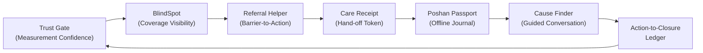
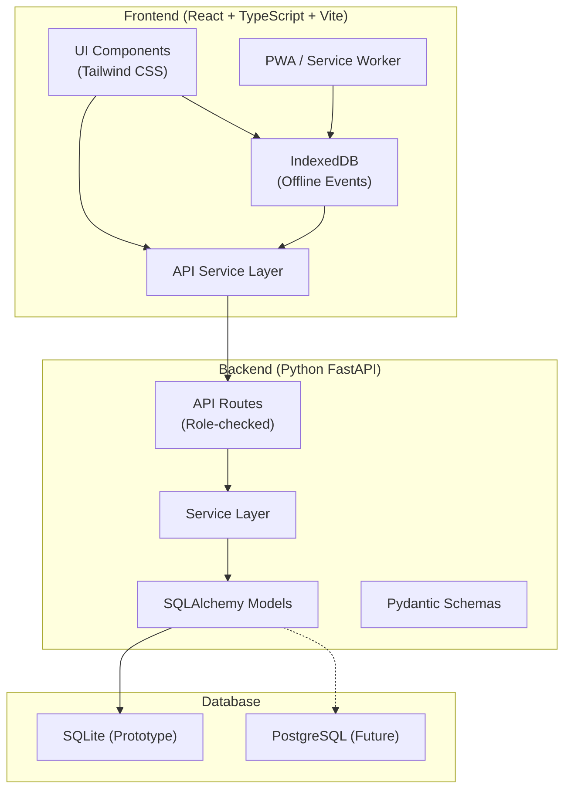
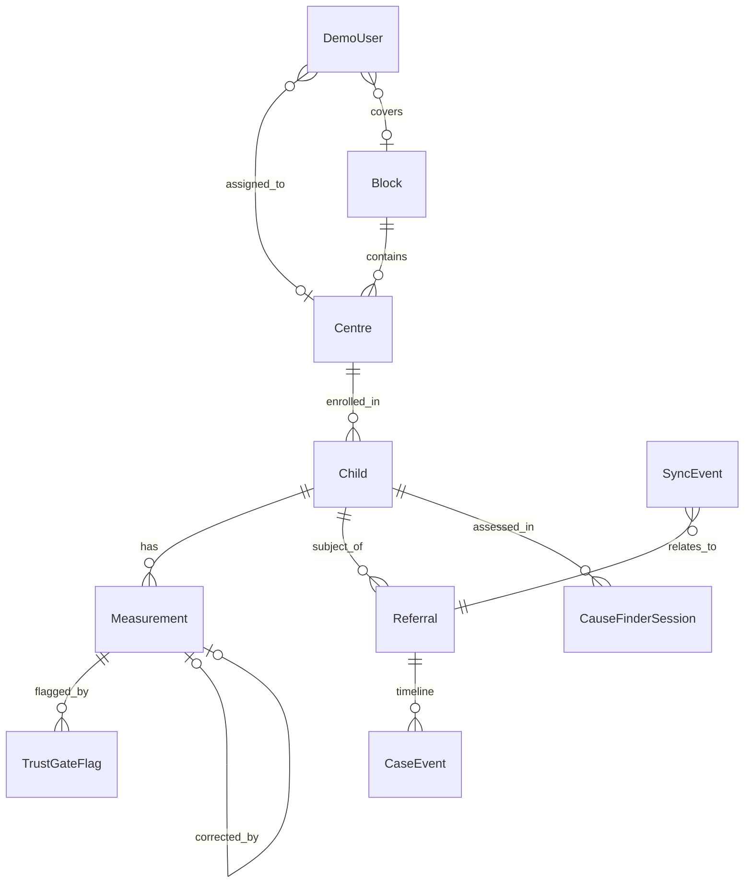
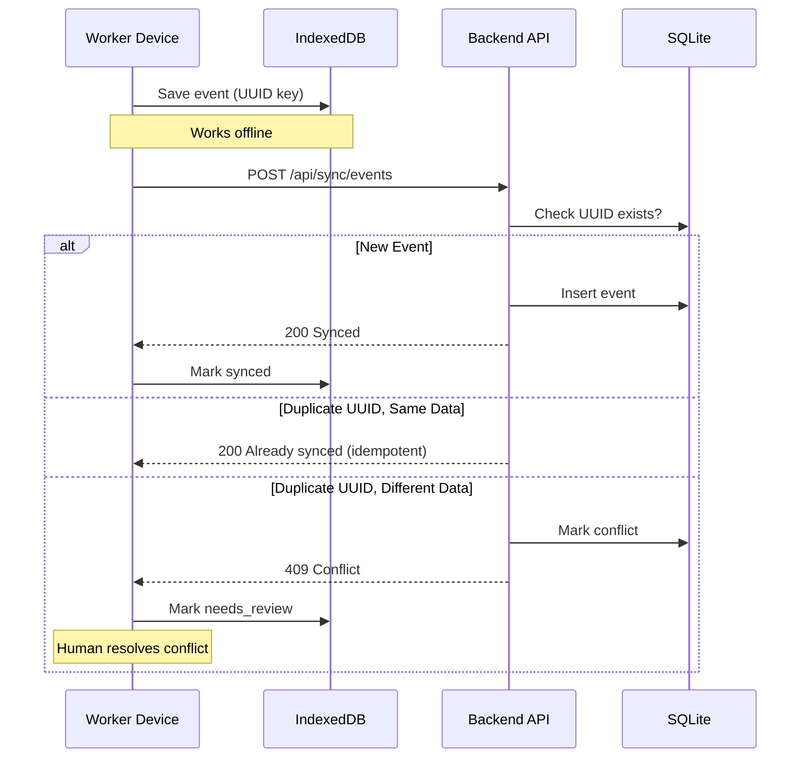
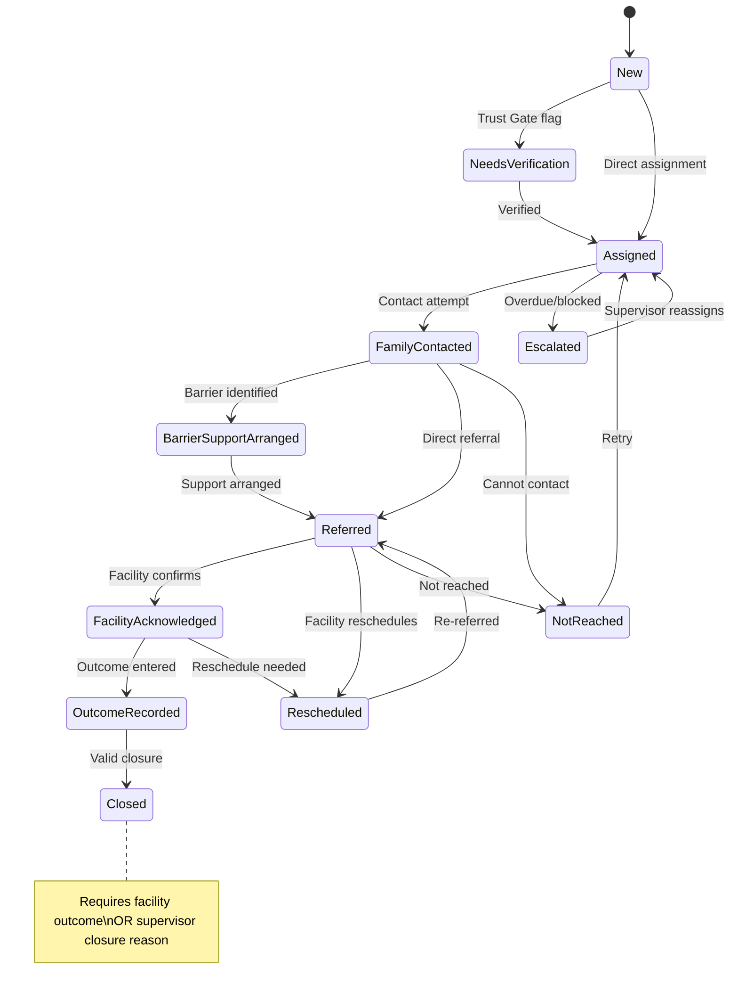

# POSHANLOOP — Architecture Document

> **Version:** 1.0.0 (Prototype)  
> **Last Updated:** November 2026  
> **Status:** Local Prototype — Not for production deployment

---

## 1. System Overview

POSHANLOOP is a **last-mile maternal and early-childhood nutrition follow-up system** designed for the India @ 71/100 Challenge. It addresses the operational gap between a child being flagged for nutritional concern and the next step of support being confirmed.

### Core Design Principle

> A case is not complete because a number was entered or a message was sent.  
> It is complete only after the **next action** and **receiving-side outcome** are recorded.

POSHANLOOP works **alongside** existing government systems (Poshan Tracker, clinical records, frontline worker judgement). It does not replace any of them.

---

## 2. Design Contribution

POSHANLOOP's contribution is **operational continuity** — ensuring that every flagged case has a verified, closed-loop follow-up trail. The six connected features form a low-burden workflow:



No individual component claims global novelty. The contribution is the **connected, low-burden workflow** that ensures operational continuity from flagging to confirmed outcome.

---

## 3. Architecture Diagram



---

## 4. Tech Stack

| Layer | Technology | Purpose |
|-------|-----------|---------|
| Frontend | React 18 + TypeScript | UI framework |
| Styling | Tailwind CSS 3 | Utility-first CSS |
| Build | Vite 5 | Fast development and production builds |
| Offline | IndexedDB (via `idb`) | Local event storage |
| PWA | vite-plugin-pwa | Service worker and manifest |
| Charts | Recharts | Status distribution (used sparingly) |
| Backend | Python FastAPI | REST API server |
| Validation | Pydantic v2 | Request/response schemas |
| ORM | SQLAlchemy 2 | Database models |
| Database | SQLite | Local prototype storage |
| Testing | pytest + httpx | Backend integration tests |

---

## 5. Data Model



### Key Entities

- **Child**: Synthetic beneficiary record with centre assignment
- **Measurement**: Weight/height/MUAC readings with metadata
- **TrustGateFlag**: Data quality alerts with review workflow
- **Referral**: Full case lifecycle from creation to closure
- **CaseEvent**: Append-only audit trail entries
- **SyncEvent**: Offline events with conflict tracking
- **CauseFinderSession**: Guided conversation records

---

## 6. API Design

All endpoints are prefixed with `/api/` and documented via OpenAPI (available at `/docs`).

### Authentication (Prototype)

The prototype uses a demo role switcher via the `X-Demo-Role` HTTP header. This is **not production authentication** — it is a demonstration mechanism only.

Roles: `AWW`, `ASHA_ANM`, `Facility`, `Supervisor`

### Endpoint Groups

| Group | Prefix | Purpose |
|-------|--------|---------|
| Overview | `/api/overview` | Dashboard aggregates |
| Children | `/api/children` | Child registry CRUD |
| Trust Gate | `/api/trust-gate` | Measurement quality flags |
| BlindSpot | `/api/blindspot` | Coverage analysis |
| Referrals | `/api/referrals` | Case management |
| Facility | `/api/facility` | Facility desk operations |
| Sync | `/api/sync` | Offline event sync |
| Cause Finder | `/api/cause-finder` | Guided conversation |
| Audit | `/api/audit` | Event trail queries |

---

## 7. Offline Architecture



### Key Offline Principles

1. Every event gets a UUID/idempotency key at creation time
2. Device-created timestamps are preserved on sync
3. Server never silently overwrites — conflicts require human resolution
4. Retry-safe: same UUID with same data returns success without duplication

---

## 8. Case Lifecycle



### Closure Rules

A case **cannot** be closed solely because a reminder was sent. Valid closure requires:
- Facility outcome of "Attended" with outcome recorded, **OR**
- Supervisor closure with documented reason

---

## 9. Security Considerations (Prototype)

| Control | Prototype Status | Production Requirement |
|---------|-----------------|----------------------|
| Authentication | Demo role header | OAuth2 / government SSO |
| Authorization | Role-checked endpoints | RBAC with audit |
| Data encryption | None (local SQLite) | TLS + at-rest encryption |
| PII handling | Synthetic data only | DPDP Act compliance review |
| Audit trail | Append-only events | Tamper-proof logging |
| Network | Local only | VPN / government network |

> **Note:** Privacy controls described here are prototype design measures that require independent legal review before any real deployment.

---

## 10. Deployment Path (Future)

```
Prototype (Current)     →  Pilot                    →  Scale
SQLite                   →  PostgreSQL               →  Managed PostgreSQL
Local dev server         →  Docker containers        →  Kubernetes
Demo role header         →  OAuth2 / SSO             →  Government SSO
No encryption            →  TLS + encryption         →  Full security audit
Synthetic data           →  Sandboxed real data       →  Production data
```

---

## 11. Limitations

This is a **local prototype** built for demonstration purposes. It is:

- ❌ Not production-ready
- ❌ Not DPDP-certified
- ❌ Not integrated with government APIs
- ❌ Not security-audited
- ❌ Not load-tested
- ✅ A working demonstration of the operational continuity workflow
- ✅ Built with production-compatible technology choices
- ✅ Designed for future migration to PostgreSQL and cloud deployment

